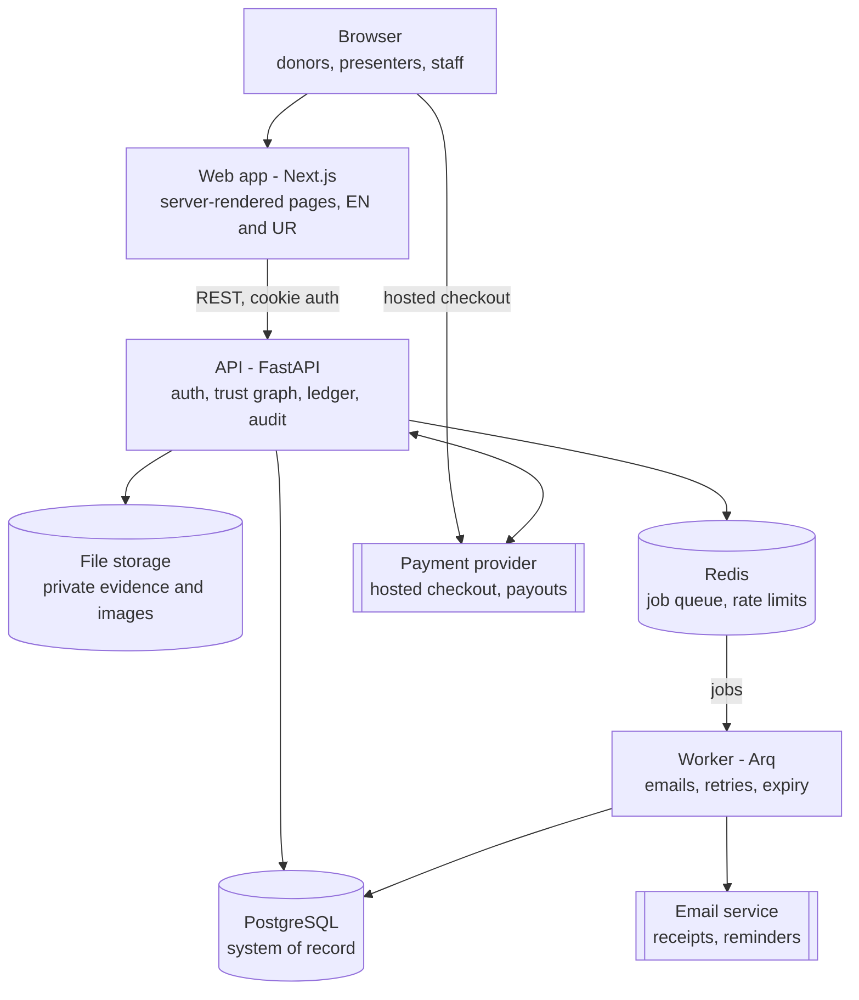

# System architecture

Wasl is two deployable services, a Next.js web app and a FastAPI API, over one PostgreSQL database. The API is the only component that touches data, files or the payment provider.

The browser reaches the payment provider only for hosted checkout; everything else goes through the web app to the API. The worker runs the API's own code against the same database. Payment provider and email service are third-party.

## Components

| Component | Technology | Responsibility |
| --- | --- | --- |
| Web app | Next.js (App Router), TypeScript, Tailwind CSS, next-intl | Server-rendered public pages for search engines and slow connections; donor, presenter, verifier and admin screens; the trust graph view; no business logic |
| API | FastAPI, Python 3.12, Pydantic v2, SQLAlchemy 2 (async), Alembic | Auth, role checks, trust graph and path search, cause lifecycle, donations, ledger, disbursements, audit log; publishes an OpenAPI schema |
| Database | PostgreSQL 16 | System of record, including trust links; full-text search for causes in the MVP |
| Worker | Arq on Redis | Emails, webhook retries, proof-of-use reminders, verification expiry, nightly ledger reconciliation |
| Cache and queue | Redis | Job queue, rate limiting, short-lived cache |
| File storage | S3-compatible bucket, private | Evidence documents and cause images; access by short-lived signed URLs only |
| Payment provider | Behind a `PaymentProvider` interface | Hosted checkout, webhooks, payouts. See [06-payments.md](06-payments.md) |
| Email | Transactional email service | Receipts, status changes, reminders |

## Design choices

- **Typed contract.** The frontend's API client is generated from the FastAPI OpenAPI schema, so a backend change that breaks the frontend fails the build.
- **Auth.** The API issues a short-lived access token and a rotating refresh token in HttpOnly, Secure, SameSite cookies. Next.js server components forward the cookie; no token is readable by browser scripts.
- **Modular monolith.** The API is one service split into modules: accounts, causes, trust, verification, donations, ledger, disbursements, admin. Nothing at MVP scale justifies separate services.
- **Provider interfaces with fakes.** Payments, storage, email and SMS each sit behind an interface with a fake implementation, so local development and tests need no external accounts.
- **Idempotent webhooks.** Every provider event is stored by its event ID before processing, so a retried webhook cannot double-count a donation.
- **Trust graph in PostgreSQL.** Trust links are rows in one table, indexed in both directions. Path search is a breadth-first search run from both ends, capped at three links (assumed), inside the API. That is fast enough well past MVP scale; if the graph outgrows it, the search moves behind the same interface to a graph extension such as Apache AGE or a dedicated graph database.
- **Visibility enforced in the search.** Path search returns only links the viewer is entitled to see. No endpoint returns the wider graph. See [the trust model](../product/03-trust-model.md).
- **Graph drawn in the browser.** The API returns a small set of nodes and links. The web app draws them with a graph library such as Cytoscape.js, and the same data backs a plain-text list for screen readers and slow devices.
- **Share previews.** Each cause page serves Open Graph tags and a generated preview image in the link's language, so a link pasted into WhatsApp shows the title, goal and progress. The preview never contains trust paths.
- **Configurable assumptions.** Path depth, trust levels, deadlines and thresholds are configuration values, because several are still unconfirmed. See [decisions](../decisions.md).
