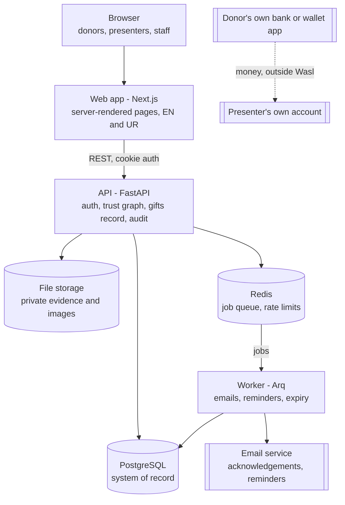

# System architecture

Wasl is two deployable services, a Next.js web app and a FastAPI API, over one PostgreSQL database. The API is the only component that touches data or files. There is no payment component: no money flows through Wasl (decision D-013, see [06-giving.md](06-giving.md)).

Everything goes through the web app to the API. The worker runs the API's own code against the same database. Money moves directly from the donor's bank or wallet to the presenter's account, entirely outside this system; Wasl only displays the presenter's payment details and records what people report.

## Components

| Component | Technology | Responsibility |
| --- | --- | --- |
| Web app | Next.js (App Router), TypeScript, Tailwind CSS, next-intl | Server-rendered public pages for search engines and slow connections; donor, presenter, verifier and admin screens; the trust graph view; no business logic |
| API | FastAPI, Python 3.12, Pydantic v2, SQLAlchemy 2 (async), Alembic | Auth, role checks, trust graph and path search, cause lifecycle, payment details, the record of gifts, proof of use, audit log; publishes an OpenAPI schema |
| Database | PostgreSQL 16 | System of record, including trust links; full-text search for causes in the MVP |
| Worker | Arq on Redis | Emails, proof-of-use reminders, verification expiry, recomputing cause totals |
| Cache and queue | Redis | Job queue, rate limiting, short-lived cache |
| File storage | S3-compatible bucket, private | Evidence documents and cause images; access by short-lived signed URLs only |
| Email | Transactional email service | Acknowledgements, status changes, reminders |

## Design choices

- **No money through Wasl.** There is no payment provider, checkout, balance or payout anywhere in the system, and none may be added. See [06-giving.md](06-giving.md).
- **Typed contract.** The frontend's API client is generated from the FastAPI OpenAPI schema, so a backend change that breaks the frontend fails the build.
- **Auth.** The API issues a short-lived access token and a rotating refresh token in HttpOnly, Secure, SameSite cookies. Next.js server components forward the cookie; no token is readable by browser scripts.
- **Modular monolith.** The API is one service split into modules: accounts, causes, trust, verification, giving, admin. Nothing at MVP scale justifies separate services.
- **Provider interfaces with fakes.** Storage, email and SMS each sit behind an interface with a fake implementation, so local development and tests need no external accounts.
- **Payment details are guarded data.** They are shown only on Live causes, any edit returns them to review, and every change is in the audit log.
- **Totals come from confirmations.** A cause's headline figure is recomputed from presenter-confirmed gifts, never from donors' unconfirmed reports.
- **Trust graph in PostgreSQL.** Trust links are rows in one table, indexed in both directions. Path search is a breadth-first search run from both ends, capped at three links (assumed), inside the API. That is fast enough well past MVP scale; if the graph outgrows it, the search moves behind the same interface to a graph extension such as Apache AGE or a dedicated graph database.
- **Visibility enforced in the search.** Path search returns only links the viewer is entitled to see. No endpoint returns the wider graph. See [the trust model](../product/03-trust-model.md).
- **Graph drawn in the browser, from data.** The API returns nodes and links. The web app lays them out and draws them with a graph library such as Cytoscape.js, with pan, zoom, path highlighting, selection and expansion. A static or hand-placed drawing is not acceptable. The same data backs a plain-text list for screen readers and slow devices. Full requirements are in the [design language](../design/design-language.md#graphs).
- **Share previews.** Each cause page serves Open Graph tags and a generated preview image in the link's language, so a link pasted into WhatsApp shows the title, goal and progress. The preview never contains trust paths or payment details.
- **Configurable assumptions.** Path depth, trust levels, deadlines and thresholds are configuration values, because several are still unconfirmed. See [decisions](../decisions.md).
