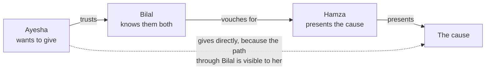
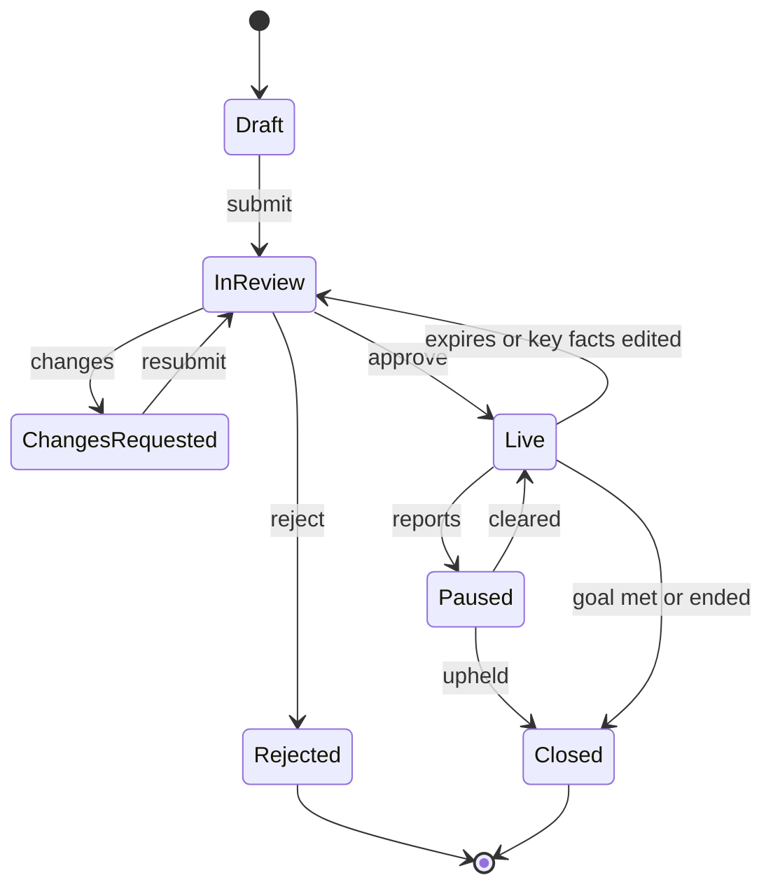

# Trust model

Wasl has two layers of trust over a baseline of platform checks.

1. **The trust graph** is the primary signal. A donor decides by seeing how they are connected, through people they already trust, to the person presenting a cause.
2. **The case record** serves any donor with no path: the case's documents, its details and the presenter's history of previous cases.
3. **Baseline checks** sit under both: a reviewer confirms the presenter's identity and that the payment details donors will use are in the presenter's name, before any cause goes live.

## The trust graph

Ayesha does not know Hamza, but she can see that Bilal trusts him. Bilal is the bridge. Ayesha is shown this path because she trusts Bilal; someone with no link to Bilal or Hamza would not see it.

### How the graph works

- **People are nodes, trust is a directed link.** Any signed-in user can say they trust another user. It runs one way: Bilal trusting Hamza says nothing about Hamza trusting Bilal.
- **Each link has a level.** Three levels: *know them*, *trust them*, *would vouch for them by name*. The level is the trust factor and sets how much weight the link carries along a path.
- **Trust is personal, not global.** No presenter has one public score. Each viewer sees the paths from themselves to the presenter, so two donors can get different answers for the same cause.
- **Paths are short.** Wasl searches up to three links away (assumed). Each extra link weakens the signal, and several independent paths count for more than one.
- **The presenter carries the trust.** The person who presents a cause is often not the person in need. Paths lead to the presenter, who answers for the case.
- **Every presenter arrives with a link.** A new presenter records who introduced them to Wasl. Once that person confirms, the introduction becomes the presenter's first trust link.
- **Trusting a person is separate from endorsing a cause.** A user can also endorse one specific cause, which says more than trusting its presenter in general.

### What a donor sees

Every cause page carries a trust panel for the signed-in viewer.

1. **The paths, in words.** "You trust Bilal. Bilal would vouch for Hamza, who presents this cause." The strongest paths are listed first, with the number of independent paths.
2. **The graph.** The same paths drawn as a real graph: laid out from the data, with pan, zoom, path highlighting and nodes the donor can expand outward. It is never a static picture; see the [graph requirements](../design/design-language.md#graphs). A separate My network page shows the donor's whole graph: who they trust, who trusts them, and the causes reachable through it.
3. **No path.** The panel says so plainly and leads with the case record instead. A donor with no connections still sees every cause and can give on that second layer alone.

A guest sees every cause, the full case record and the overall vouch count, with a prompt to sign in to see their own paths.

### Keeping the graph honest

- **Fake networks lead nowhere.** Paths start from the viewer. A cluster of fake accounts vouching for each other has no path to a real donor unless a real person links to it.
- **One person, one account.** Trust links need a verified phone number, and a new account cannot vouch at the top level for its first 30 days (assumed).
- **A vouch has consequences.** If a cause is closed for fraud, everyone who vouched for the presenter by name is told, the donors who recorded a gift are told, and the failed vouch stays visible to the people who trust them.
- **Links are visible only along the graph.** My link to Hamza is shown to people who trust me, and to Hamza. It is never public and never listed in search.
- **Links can change.** A user can lower or withdraw trust at any time. The change takes effect at once and the history is kept in the audit log.
- **Asking is rate-limited.** A presenter can invite contacts to vouch, but invitations are capped per day to stop pressure campaigns.

## The case record

Every cause page shows the case record to everyone, connected or not. It is what a donor with no path relies on, and what a connected donor uses to confirm what the graph suggests.

| Part | What the donor sees |
| --- | --- |
| Case information | The story, the goal, a breakdown of how the money will be used, location, and progress so far |
| Documents | Supporting documents the presenter publishes, such as a medical letter, fee notice or supplier quote, with personal identifiers redacted. Each is marked if a reviewer has checked it against the original. |
| Presenter history | Previous cases by the same presenter: how many, how much was raised, how many finished with proof of use posted on time, and any paused or closed after reports. A first-time presenter is labelled as such. |
| Updates | Proof-of-use updates for this case, with receipts and photos |
| Giving record | The amount the presenter has confirmed receiving, and how much of it proof of use has accounted for |
| Baseline checks | Identity and payment details confirmed, with the date |
| Vouch count | How many people vouch for the presenter overall, without names |

Identity documents are never published. Only documents about the case itself can be, and only by the presenter's choice. Payment details are shown on the cause page while it is Live, because donors pay the presenter directly.

## Baseline checks

The graph does not replace the checks a reviewer makes before any cause goes Live. Because donors send money straight to the presenter and Wasl can never return it, the presenter's identity and payment details are checked regardless of who vouches. A fuller evidence review is optional and earns a separate Platform-checked badge.

| Check | Evidence | When |
| --- | --- | --- |
| Identity | Government ID of the presenter, matched to a verified phone number | Required before any cause goes Live |
| Payment details | Each bank account or wallet donors will pay into is in the name of the presenter or organisation, shown by a bank letter, statement or wallet record | Required before any cause goes Live, and again after any change |
| Legal standing | Charity or NGO registration certificate, checked against the public register | Required for organisations |
| Beneficiary consent | Recorded consent from the person in need, or their guardian, when the presenter is someone else | Required when presenter and beneficiary differ |
| Need | Documents for the specific appeal: medical letter, school fee notice, project plan, quotes | Optional; earns the Platform-checked badge |

Rules for the baseline checks:

- **Two-person rule.** A second verifier signs off any cause with a goal above a threshold set by admins.
- **Conflict of interest.** A verifier cannot review a cause they present or have declared a link to.
- **Expiry.** Verification lapses after 12 months (assumed) or when the presenter edits the goal, the payment details or the story's key facts. The cause returns to review and its payment details are hidden until it passes.
- **Reports.** Any visitor can report a cause. Three open reports (assumed), or one from a verifier, pause the cause, which hides its payment details, until an admin decides.
- **Transparency.** The cause page shows which checks passed, the date, and the reviewer's role. Identity documents are never shown; case documents appear only when the presenter publishes them.

## Cause lifecycle

A cause is public, and its payment details visible, only while it is in the Live state.

Every transition is a recorded decision by a named person, except expiry, which the worker triggers. Rejected and Closed are final; a rejected presenter starts a new submission.
