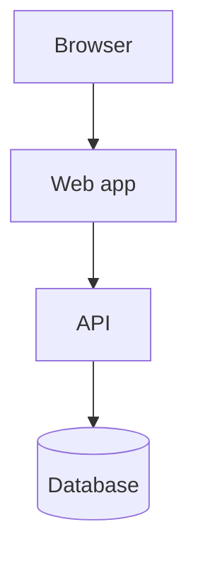

# System architecture

[One sentence: how many deployable parts, over what storage, and which part is the only one that touches data.]

[One or two sentences reading the diagram.]

## Components

| Component | Technology | Responsibility |
| --- | --- | --- |
| [Component] | [Technology and version] | [What it does, and what it must not do] |

## Design choices

> Guidance: one bullet per choice a reviewer might question. Bold the choice, then say why in a sentence.

- **[Choice].** [Why.]
- **Configurable assumptions.** Values still marked "assumed" are configuration, not constants. See [decisions](../decisions.md).
